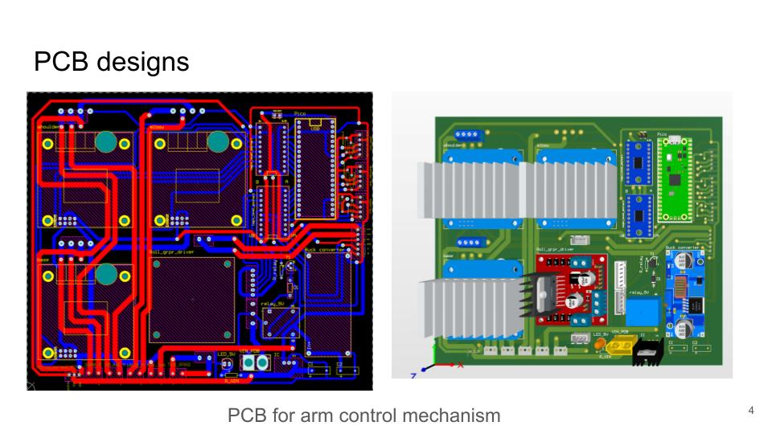
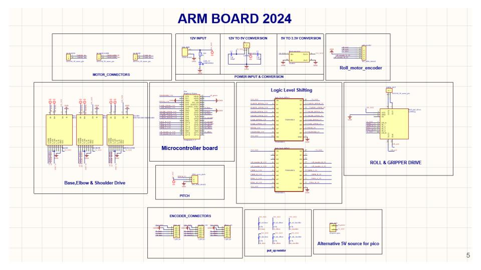

# arm_procheshtaV3.0
The pcb layout of the latest version of arm control board of Prochesta v3.0 , a Mars rover designed for international competitions like URC, ERC and ARC.

# Procheshta V3.0 – Robotic Arm Control PCB

This repository contains the schematic, PCB layout, and manufacturing files for the robotic arm control board of **Procheshta V3.0**, a Mars rover developed by the **BUET Mars Rover Team** for international competitions such as the University Rover Challenge (URC), European Rover Challenge (ERC), and Anatolian Rover Challenge (ARC).

## 1. Mars Rover and Robotic Arm

The rover features a 5-degree-of-freedom robotic arm equipped with a gripper for performing various manipulation tasks.

## 2. Robotic Arm Demonstration

With the help of onboard cameras, the robotic arm is designed to perform tasks such as:

- Turning knobs and flipping switches
- Undoing latches
- Pulling ropes
- Picking up and placing objects
- Opening and closing drawers
- Plugging in USB connectors

## 3. Microcontroller Selection

The robotic arm control system requires approximately **11 PWM outputs** for controlling its motors and actuators.

Two microcontroller options were considered:

- **Arduino Nano:** 6 hardware PWM pins
- **Raspberry Pi Pico:** 16 controllable PWM channels

The **Raspberry Pi Pico** was selected because it provides sufficient PWM channels for the robotic arm's control requirements.

## 4. PCB Design

The custom PCB integrates the motor control, power conversion, microcontroller interfacing, and signal connections required for operating the robotic arm.

The design includes:

- Motor driver connections for the base, shoulder, and elbow
- Roll and gripper motor control
- Pitch control connections
- Raspberry Pi Pico microcontroller interface
- Logic-level shifting circuitry
- Encoder connections
- Power input and voltage regulation

## 5. Circuit Schematic

The schematic is organized into the following functional blocks:

- Motor connectors
- Base, elbow, and shoulder motor drivers
- Roll and gripper drive
- Pitch control
- Microcontroller board
- Logic-level shifting
- Encoder connectors
- 12V power input
- 12V-to-5V conversion
- 5V-to-3.3V conversion

## 6. Repository Contents

The repository includes the following design and manufacturing files:

| File Type | Description |
|-----------|-------------|
| `.SchDoc` | Altium Designer circuit schematic |
| `.PcbDoc` | PCB layout and routing |
| `.PrjPcb` | Altium Designer project file |
| `.IntLib` | Integrated component library |
| `top layer.pdf` | Top copper layer |
| `bottom layer.pdf` | Bottom copper layer |
| `top overlay.pdf` | Top silkscreen overlay |
| `bottom overlay.pdf` | Bottom silkscreen overlay |
| `top resist.pdf` | Top solder-mask layer |
| `bottom resist.pdf` | Bottom solder-mask layer |

## 7. Project Information

**Project:** Procheshta V3.0 Mars Rover

**Team:** BUET Mars Rover Team

**Role:** PCB Manufacturing Lead

**Design Software:** Altium Designer

**Microcontroller:** Raspberry Pi Pico

---

Developed as part of the BUET Mars Rover Team's robotic arm control system.

